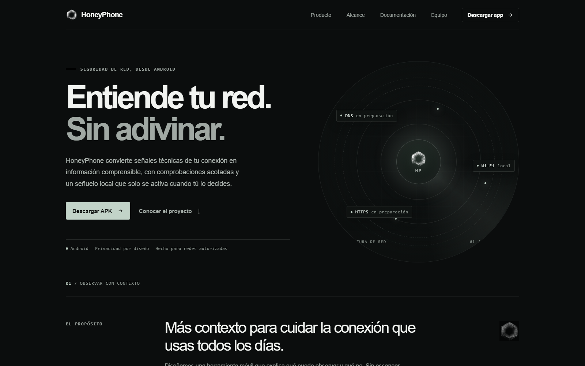

<p align="center">
  
</p>

# HoneyPhone Web

<p align="center"><strong>La puerta pública al proyecto HoneyPhone.</strong><br />Landing estática con Next.js · documentación de API · descarga Android</p>



Este repositorio contiene la landing pública de HoneyPhone. Presenta el propósito y alcance del producto, resume sus funciones y enlaza a la documentación de la API y al APK Android.

## Contenido del sitio

- Introducción al producto y a sus límites de uso.
- Resumen de indicadores Wi-Fi, pruebas controladas DNS/HTTPS, señuelo local y cuentas.
- Flujo de uso y enlaces a Swagger UI y al esquema OpenAPI.
- Enlace de descarga con la versión visible del APK.

DNS/HTTPS se describen como pendientes cuando no hay destinos controlados configurados. La landing no procesa cuentas ni almacena datos de usuario.

## Tecnologías

- Next.js App Router con exportación estática (`output: "export"`).
- React, TypeScript y CSS.
- Nginx en el contenedor de producción para servir `out/`.

Requiere Node.js 20.9 o posterior. Las versiones exactas de paquetes están fijadas en `package-lock.json`.

## Desarrollo

Desde la raíz de este repositorio:

```bash
npm ci
npm run dev
```

Abre `http://localhost:3000`. Para revisar las reglas de ESLint ejecuta `npm run lint`; para generar la exportación ejecuta `npm run build`, que produce el directorio `out/`.

## Contenedor de producción

```bash
docker build -t honeyphone-web .
docker run --rm -p 8080:80 honeyphone-web
```

Abre `http://localhost:8080`. El contenedor compila la app y copia la exportación estática a Nginx; no requiere un servidor Next.js en ejecución.

## Configuración del contenido

Edita [`src/lib/site.ts`](src/lib/site.ts) para cambiar el origen de la API, sus enlaces de documentación, la versión mostrada y la URL del APK. Son valores públicos que quedan incluidos en los archivos del sitio; no pongas secretos en el frontend.

## Estructura

```text
src/
├── app/          # página, layout y estilos globales
└── lib/site.ts   # URLs públicas y versión visible del release
public/           # logotipo y recursos estáticos
Dockerfile        # build estático y servidor Nginx
```

La guía operativa de EC2 está en el workspace que contiene este repositorio: `../operacion/landing-ec2-publicar.md` (ese archivo vive fuera de este repositorio).

## Licencia

El código propio de este repositorio se distribuye bajo MIT; consulta [`LICENSE`](LICENSE). Las dependencias, tipografías y recursos de terceros conservan sus licencias respectivas.
